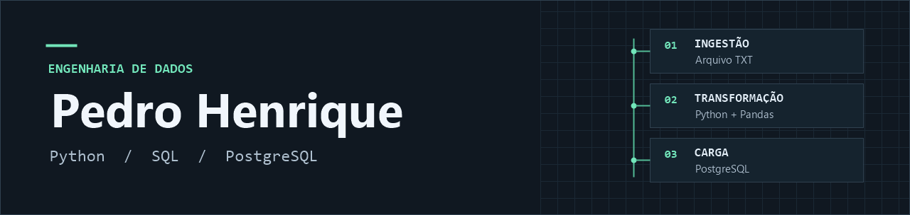

### Sobre mim

Curso **Engenharia de Software em Goiás** e busco estágio em **Engenharia de Dados**. Desenvolvo pipelines em Python e SQL, da ingestão de dados semiestruturados à validação e carga em bancos relacionais. Tenho certificação em **Engenharia de Dados pela DataCamp**.

## Projeto principal

### [Pipeline ETL de contatos](https://github.com/pedrohenriqueinv/etl-contacts-pipeline)

Transforma listas de contatos em TXT em registros estruturados para consulta no PostgreSQL.

| Etapa | Implementação |
| --- | --- |
| **Ingestão** | Leitura de arquivos TXT em UTF-8, com caminho configurável. |
| **Transformação** | Parser em Python, normalização de campos, tipagem e deduplicação com Pandas. |
| **Carga** | Transação via SQLAlchemy e upsert no PostgreSQL com `ON CONFLICT (email) DO UPDATE`. |
| **Automação** | Workflow agendado no GitHub Actions, suíte pytest e logs por etapa. |

[Implementação do ETL](https://github.com/pedrohenriqueinv/etl-contacts-pipeline/blob/HEAD/pipeline/etl.py) · [Testes](https://github.com/pedrohenriqueinv/etl-contacts-pipeline/blob/HEAD/tests/test_etl.py) · [Workflow](https://github.com/pedrohenriqueinv/etl-contacts-pipeline/blob/HEAD/.github/workflows/pipeline_schedule.yml)

## Mais projetos e estudos

**[LOGOS](https://github.com/pedrohenriqueinv/LOGOS)** — plataforma de estudo com exercícios executáveis de Python/Pandas e SQL. O código roda no navegador via WebAssembly, com Pyodide para Python e PGlite para PostgreSQL.

**[Estudos de Engenharia de Dados](https://github.com/pedrohenriqueinv/data-science-studies/tree/HEAD/data-engineering)** — anotações e exercícios de ingestão, limpeza de dados, ETL/ELT, testes de integração e orquestração com Apache Airflow.

## AI Builder · Aplicações e orquestração de agentes

- **[LOGOS](https://github.com/pedrohenriqueinv/LOGOS)** · progressão opcional de dificuldade nos cartões de revisão com Gemini, integrada ao agendamento FSRS e aos exercícios executáveis de Python e SQL.
- **[GEMUL Professor](https://github.com/pedrohenriqueinv/acq-edu)** · integração com a API Gemini para gerar planejamentos estruturados, com revisão e edição pelo usuário antes da exportação.
- **Orquestração de agentes** · desenho fluxos com planejamento, implementação, revisão e validação. Uso roteamento por complexidade para escolher modelos e critérios de aceite para decidir quando encerrar ou repetir uma rodada.

## Stack técnica

| Área | Tecnologias e práticas |
| --- | --- |
| **Engenharia de dados** | Python · SQL · Pandas · ETL · parsing de texto · tipagem, normalização e deduplicação |
| **Bancos e acesso a dados** | PostgreSQL · SQLite · Supabase · SQLAlchemy · psycopg2 · transações e upsert |
| **Apps e frameworks** | Flask · Streamlit · TypeScript · React · Next.js · Tailwind CSS |
| **Processamento e visualização** | OpenPyXL · Recharts · Pyodide · PGlite · WebAssembly |
| **IA aplicada** | Gemini API · geração estruturada · revisão humana · orquestração de agentes · roteamento de modelos |
| **Testes e automação** | pytest · Git · GitHub Actions · workflows agendados |
| **Em estudo** | Apache Airflow · NumPy · Parquet · fundamentos de cloud |
